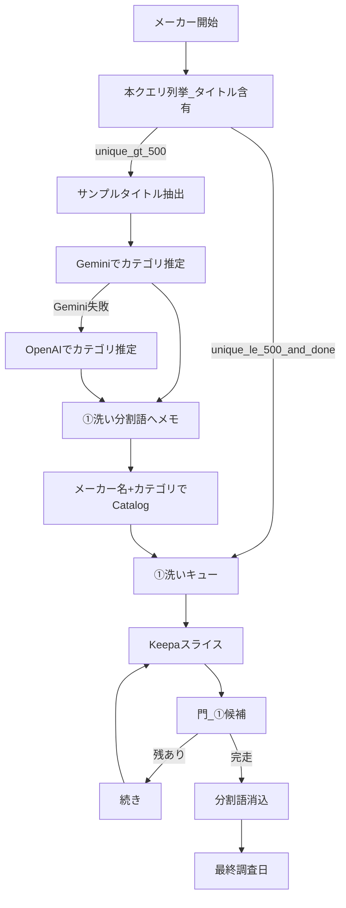

# メーカー洗い完走（案A+C）要件定義

**日付**: 2026-08-21  
**状態**: P1b 実装済（要 clasp）。分割＝タイトルからカテゴリ推定 B（Gemini→OpenAI）  
**親**: [FLOW](B_PURCHASE_RESEARCH_FLOW.md) B／[V1](B_PURCHASE_RESEARCH_V1_REQUIREMENTS.md)  
**手順**: [HUMAN_RUN](B_PURCHASE_RESEARCH_HUMAN_RUN.md)  
**AI**: [AI_ROUTING](../AI_ROUTING_GEMINI_OPENAI.md)（本処理は **Gemini 主・OpenAI は Gemini 失敗時のみ**）。既定モデル `gemini-3.6-flash`（Property `PR_GEMINI_MODEL` で上書き可）

---

## 0. 実装フェーズとドライラン（明示）

| 段 | 内容 | 実装 | ドライラン |
|----|------|------|------------|
| **P0** | 本 docs | **済** | — |
| **P1a** | キュー＋本クエリ列挙（≤500） | コードあり（要 clasp） | 石原 **PASS** |
| **P1b** | **>500 → タイトルからカテゴリ推定（Gemini→OpenAI）→分割語シート→語ごと列挙→消込** | **済** | GAS尾西列挙 **PASS** `pr_20260821_081436` 分割列挙完了。キュー935ユニーク／分割語15すべて済。Keepaは未（P2） |
| **P2** | Keepaスライス＋続き＋完走時日付 | **済** | **PASS（1スライス）** `pr_20260821_123216`。続けてループメニュー追加 |
| **P2b** | **洗い完走ループ**（1実行内でスライス反復・トリガーなし） | **済** | **条件付PASS** Keepa済380まで。429で停止→温和停止へ修正 |
| **P3** | **トリガー再開**（完走まで自動・承認済） | **済** | **PASS** 尾西完走後、実行安定＋upsert＋門出品者数＋D1補強を追加（要 clasp） |
| 旧 cap20 | 探索用 | 残置 | 既存 |

切戻し: `PR_MAKER_WASH_FULL_ENABLED=false`

---

## 1. 正の定義（ロック）

**自動リサーチ**＝対象メーカーについて、Catalog 列挙を尽くし、キュー上の全 ASIN に Keepa→門→①候補まで行い、**完走したときだけ「調査完了」**。

| 用語 | 意味 |
|------|------|
| **完走** | `①洗いキュー` の当該メーカーで Keepa未済が0。門→①候補まで済。分割語も消込済 |
| **cap（既定30）** | 1実行の Keepa 仕事量。**完了条件ではない**。Property `PR_MAKER_WASH_CAP`（上限50） |
| **最終調査日** | **完走日のみ** |
| **旧 cap20 page0** | 探索用。本線ではない |

---

## 2. フロー（案A＋分割B）

| 段 | 内容 |
|----|------|
| **A** | ASIN を一時キューへ列挙し切ってから Keepa 完走 |
| **分割B（ロック）** | >500 のとき、**ヒットタイトルからカテゴリ推定** → 一覧を一時シートにメモ → `メーカー名＋カテゴリ` で順に再検索 → **完走後に消込** |

**廃止（洗い完走の分割正としては使わない）**: マスタ第2語が空なら止めるだけ、を本線にする方式。  
**メーカーマスタ第2語**: 任意の種・人手補正用に残してよいが、**>500 時の自動分割の正は B（タイトル推定）**。

---

## 3. シート・置き場

| もの | 置き場 | 備考 |
|------|--------|------|
| ASIN キュー | 調査複製 **`①洗いキュー`** | 門前の生 ASIN |
| **分割語キュー** | 調査複製 **`①洗い分割語`**（新） | カテゴリ一覧・進捗・消込 |
| ①候補 | 調査複製 | Keepa＋門のみ |
| メーカーサマリ | 競合DB | 洗い状態・最終調査日 |
| メーカーマスタ | 競合DB | 任意の種／人手。分割の必須入力ではない |

### 3.1 `①洗いキュー` 最小列

メーカー／入口語／ASIN／列挙日時／Keepa済／門結果／メモ

- **同一メーカー×ASINは1行**（追記時スキップ。重複が残っていれば列挙／Keepa前に削除）。
- Keepa未済の取り出しも ASIN ユニーク。処理後は同 ASIN 行をすべて Keepa済にする。
- Keepa GET 自体は `prKeepaProductStats90_` が Keepaフル90日ヒットを先に使う（トークン二重消費を避ける）。
- **保持**: Keepa済かつ列挙日時が **既定90日（3か月）** より古い行は削除可。メニュー「洗いキュー 期限切れ削除」。切替 `PR_WASH_QUEUE_RETENTION_DAYS`（0=オフ）。未済・列挙日時空は残す。
- **完走時（2026-11-10）**: 当該社の Keepa済を即削除（`PR_WASH_QUEUE_PURGE_DONE`。未設定=ON）。メニュー一括は終わり状態の社の済＋日数条件。正本 CYCLE §6.7.4。
- **未済上限（2026-11-10）**: 未済行≥50,000 で新規社への列挙追記を止める（`PR_WASH_QUEUE_PENDING_ROWS_MAX`）。洗いは続行。CYCLE §6.7.4bis。

### 3.2 `①洗い分割語` 最小列（ロック）

| 列 | 意味 |
|----|------|
| メーカー | 親名 |
| 分割語 | カテゴリ短語（Catalog keywords 用） |
| 状態 | 未／列挙中／済 |
| 推定元 | `gemini`／`openai`／`人手` |
| サンプル数 | 推定に使ったタイトル件数 |
| 列挙ASIN数 | その語でキューに足した累計 |
| nextToken | Catalog 続き用。途中停止時に保存。済で空 |
| 更新 | 日時 |

- >500 分岐に入ったら、推定結果を **全行メモ**してから語ごと列挙。
- 語の列挙は **nextToken を保存して再開**（頁上限・時間切れで毎回先頭からやり直さない）。
- 語の状態がすべて **済** かつ ASIN キューの Keepa 完走後、**当該メーカーの分割語行を削除（消込）**。失敗で止まった語は残す（続き用）。

---

## 4. Catalog 列挙と分割B

1. 入口＝メーカー名（ブランド型は現行入口語／needle）。
2. pageSize=20＋`nextToken`。**既定OR（2026-10-27）**: メーカー名検索ヒットを **調査カテゴリONルートだけ**キューへ（`PR_CATALOG_SURVEY_ROOT_GATE` 省略=ON。分類欠測も入れない）。照合は **`parent` 辿り**（2026-10-28。切戻し `PR_CATALOG_CLASSIF_WALK_PARENT=false`＝先頭ノードのみ）。商品名／ブランドヒットは包含（ノーブランド可）。旧ANDは `PR_CATALOG_TITLE_GATE=true`。調査カテゴリ切戻し `PR_CATALOG_SURVEY_ROOT_GATE=false`。
3. **≤500 かつページ尽きた** → 分割不要。キュー確定。
4. **>500**（本クエリ列挙中にユニークが閾値超）:
   1. それまでに得たタイトル（上限例: 200件サンプル）を入力に **カテゴリ短語リストを推定**。
   2. **AI: 必ず Gemini 先。Gemini が失敗（エラー／空／パース不可）のときだけ OpenAI。** OpenAI を先に呼ばない（コスト）。
   3. 結果を `①洗い分割語` に書く（状態＝未）。
   4. 各語について `メーカー名 + 分割語` で Catalog 列挙 → `①洗いキュー` へ（重複 ASIN スキップ）。語ごと状態＝済。
   5. 推定失敗かつ人手語も無い → サマリ **要分割語**（人介入）。
5. page0 満杯だけでは分割しない（件数閾値が正）。
6. Catalog 生はモールヒットに書かない。

### 4.1 推定プロンプトの約束（実装時）

- 出力は **短いカテゴリ語のリストのみ**（例: みそ汁／カレー／おかゆ）。パイプ or JSON 配列。
- 冷凍・生鮮など門で落ちやすい語は入れない（石原ナビの教訓に合わせる）。
- 語数上限（例: 15）を Property で持てるとよい。

### 4.2 社名の法人格ゆれ（2026-09-09・`PR_MAKER_NEEDLE_LEGAL` 省略=ON）

**タイトル含有の判定は商品名＋ブランドの `indexOf` 完全一致**（`prCatalogTitleHits_`）。マスタの表示名が `大平水産(株)` だと、Amazon の商品名（`大平水産 …` / `【大平水産株式会社】…`）は**1件も通らず**タイトル含有0になる。カッコ株を商品名に書く商品は事実上存在しない。

- 手作業の裏取り（2026-09-09）: Keepa 製品ファインダーの製造者は `大平水産株式会社`=209件・`大平水産`=一致なし。`(株)` 表記は**どちらにも無い**。マスタの書き方だけが実在しない形だった。
- 心拍からの列挙は `prMakerWashNeedles_(parent, '')` で**入口語ヒットが空**＝照合語が表示名1個だけ。まとめ列挙（§CYCLE）が使うのはこの経路なので、ここが一番弱い。

**正**:

1. 表示名から `prMakerLegalVariants_` で **法人格なし／＋株式会社／株式会社＋** を生成し照合語に足す。**表示名は先頭のまま**（既存の突合を壊さない）。`(有)` 系は `有限会社` を付ける。
2. 法人格が付いていない社は増やさない。法人格を落とした語が **3文字未満**（`PR_MAKER_NEEDLE_MIN_LEN_`）なら足さない（短い語で無関係な商品を巻き込むのを防ぐ）。
3. 検索キーワード（`keywords`）は**タイトル含有0のときだけ**法人格なしで**1回だけ**言い換えて再列挙（ログ `legal_retry`）。現に動いている社の列挙量を変えないため、常時の言い換えはしない。
4. 名寄せ関数は既存の `prNormalizeMakerKey_`（モンテ物産の法人格ゆれ対応で追加）を再利用する。**同じ正規化を2つ書かない。**

ログ: `needle_variants parent=… add=…`／`legal_retry parent=… entry=… -> …`。切戻し `PR_MAKER_NEEDLE_LEGAL=false`（表示名だけ）。

### 4.3 ①候補の所有権は奪われる前提で数える（2026-09-10・`PR_CAND_PASS_BY_QUEUE` 省略=ON）

§4.2 のとおり照合は**部分一致**なので、社名が包含関係にある社は**互いの商品を取り込む**。`中村食品` の照合語は `中村食品産業 感動の…` という商品名にも当たる。2026-09-10 時点のメーカーサマリ415社で、**社名が他社名に含まれる組は53組**（浜乙女／株式会社浜乙女、ニチレイ／ニチレイフーズ、ペンギン食堂／有限会社ペンギン食堂、黒糖本舗垣乃花／株式会社黒糖本舗垣乃花 ほか）。名寄せをしても、キューは社ごとに分かれているので重なりは残る。

一方 `prUpsertCandidate_` は **1ASIN=1行**で、`row[0]=parent` を上書きする。つまり**後に洗った社が所有者になる**（実測: ①候補12,683 ASIN すべて1行ずつ・複数メーカーに跨る行はゼロ＝排他）。

**この結果、先に洗った社の合格が他社名義になり、門通過0に見える。**

- 実例（2026-09-09）: `B096T9YHWD` = 商品名「**中村食品産業** 感動の未粉つぶ片栗粉 200g 2袋セット」、メーカー列「**中村食品**」。中村食品産業（03:04–03:10・`pass=1`）の唯一の合格が、中村食品（03:41–03:50）の洗いで移った。中村食品産業に残ったのは13行すべて落ち。
- これが偽完了救済（CYCLE §6.4）を誤発動させ、25時間の空転につながった。

**正**: `prCandGatePassCountForMaker_` は**メーカー列の一致で0件のときだけ**、自社の `①洗いキュー` にある ASIN が①候補で通過しているかを見て数える。奪われていても自社の合格として扱う。

- 呼び出し側はどれも「>0 か」しか見ないので、自社名義が1件でもあればそこで打ち切る（サマリ全社ぶんのキュー走査をしない）。
- ①候補の通過行は実行内1回だけ読む（`prCandPassSnapshot_`。`PR_CAND_MEM_` を再利用するのでシート読みは増えない）。`prUpsertCandidate_` で破棄する。
- **所有者そのものは付け替えない**（D1 の転記元・履歴を動かさないため）。数え方だけを直す。

ログ: `cand_pass_by_queue parent=… own=0 stolen=… owner=…`。切戻し `PR_CAND_PASS_BY_QUEUE=false`（メーカー列一致のみ）。

---

## 5. Keepa 完走

未済スライス → フル追記 → 門 → ①候補。完走時のみ最終調査日。完走後に **分割語消込** と **調査CK解除**。

### 5.1 Keepa GET は2段ゲート（2026-09-07・`PR_KEEPA_TWO_STAGE_GATE` 省略=ON）

**根拠**: 門（`prGateProductRow_`）が見るのは価格・順位・出品者数・タイトルで、**すべて `stats` にある**（出品者数は `stats.current[11]`）。`offers=20` は門の判定に **使っていない**。実測の通過率は **3%**（2026-09-07 の120件中4件）。

| 段 | GET | 対象 | 単価 |
|----|-----|------|------|
| 1段 | `history=0&stats=90`（**offers なし**） | キャッシュに無い全件 | **1トークン/件** |
| 2段 | `history=0&stats=90&offers=20` | **1段で門を通ったものだけ** | 約5トークン/件 |

- 1件あたり **約5 → 約1.2トークン**（1＋0.03×5）。
- **Keepaフルへ書くのは 落ちの薄い行と 通過の太い行**。薄い行も残すのは、閾値を変えたときに **GETなしで再門**（`PR_REGATE_FROM_FULL_ENABLED`）できる資産だから。
- 通過なのに2段目が届かなかったとき: **429 なら確定させない**（Keepa済にせず次スライスで取り直す）。429 でないなら薄いまま確定し、**BuyBox は D1 補強 GET が後で埋める**（§5.2）。永久保留を作らない。
- 単価プロファイルは `product_two_stage`（既定2＝安全側。`KEEPA_TWO_STAGE_TOKEN_COST` で上書き）。ログ `two_stage=1段件数/2段取得件数`。

### 5.2 D1 補強 GET の条件を1つ足す（`PR_D1_ENRICH_BLANK_BB` 省略=ON）

案A（**Keepaフルに行があれば再GETしない**）は維持しつつ、**門通過なのに `BuyBoxセラー` と `BuyBox_FBA` が両方空**の行だけ1回太らせる。2段ゲート後は落ちが薄い行で残るため、再門で通過に変わった行の BuyBox が欠けて店レーンが拾えなくなるのを防ぐ。

実測 2026-09-07: ①候補の通過 **782件中5件**だけ該当（Keepaフル全体の空1,021件＝12.1% はほぼ落ち行）。空回りを避けるため **1回20件上限**（`PR_D1_ENRICH_CAP`）。

### 5.3 Keepa が返さない ASIN は見切る（2026-09-09・`PR_KEEPA_MISS_DONE` 省略=ON）

**事故**: `no_product`（要求したのに Keepa が返さない ASIN）は `doneAsins` に入らないため `①洗いキュー` に残り続け、`left` が減らない。`wrote=0` で `LOOP stop wrote0` → 再予約 → 同じ ASIN を取り直す、を**4分ごとに繰り返す**。実測 2026-09-08 19:33〜20:52 の**1時間20分で27回**（アリアケジャパン・`want=2 wrote=0 left=2 two_stage=2/0`）。毎回トークンを消費し、効率合否 `cause=wrote0` の FAIL が20件出た。

**正**:

- ASIN→取れなかった回数を `PR_KEEPA_MISS_JSON` に持つ。**2回**（`PR_KEEPA_MISS_DONE_AFTER`）で **Keepa済にして落とす**。
- **取れたら回数はリセット**（一時的な取りこぼしを永久化しない）。
- Property は **500件上限**で古い順に間引く（`PR_KEEPA_MISS_MAX_KEYS_`）。書き込みはスライス末尾に1回だけ（ASINごとに書かない）。
- `notReady`（2段目が429で届かなかった）は**この回数に数えない**。別の仕組みで次スライスに回す（§5.1）。

ログ: `keepa_miss_done asin=… n=… parent=…`／①ログの `miss=`。切戻し `PR_KEEPA_MISS_DONE=false`。

---

## 6. 既存資産の位置づけ（更新）

| 既存 | 今回 |
|------|------|
| メーカーマスタ第2語 | **任意種・人手**。自動分割の正ではない |
| 公式ナビ／Gemini 採取（V1） | 分割Bの Gemini 推定と思想は近い。入力は **Catalog タイトル** が正 |
| 入口推奨／needle | 入口クエリ用のまま |
| Keepa 待ち計算 | 流用 |

---

## 7. 状態（メーカーサマリ）

| 状態 | 意味 |
|------|------|
| 未着手 | — |
| 列挙中 | Catalog／分割語の途中 |
| 分割推定中 | >500 で AI 推定中 |
| Keepa中 | 列挙完了・Keepa未済あり |
| 要分割語 | 推定失敗・人手待ち |
| 完了 | キュー消化＋分割語消込＋最終調査日＋調査CK解除 |

| 保留 | 非仕入先／要確認。要確認は列 **実態ck** に Amazon 検索URL（メーカー名入力済み）。M列「実態」はラベルのまま。人は URL をクリックして判断→実態を確定 |

---

## 7bis. 行数肥大対策（今後必須。2026-09-07 メモ）

**前提**: `①洗いキュー` は増える一方（実測 26,238行 = Keepa済 8,095／未済 18,143。86社）。
**方針**: **行を消して軽くするのではなく、行数に比例した読みを作らない。**

| 判断 | 内容 |
|------|------|
| 未済行を消す | **しない**。調査したい商品そのもの。消せば Catalog 列挙をやり直す |
| 大・特大を消す | **しない**。列挙コストの捨て。膨張予防は「**入口で列挙しない**」側で行う |
| 保持日数を短縮 | **効かない**（実測: 14日より古い Keepa済＝**0行**。列挙は直近2週間ぶん） |
| Keepa済を完走時に消す | 後回し（31%減。選定24分→17分では足りない） |
| **全走査をやめる** | **本命**。件数は「メーカー→件数」表を1回作って共有する |

**守ること（新規実装・改修時のチェック）**

1. **メーカー1社ごとにキュー全行を読む処理を作らない。** 件数だけなら `prWashQueueUniqCount_`（実行内キャッシュ）を使う。`prWashQueueAsinSet_` は「その社のASIN集合そのもの」が必要な列挙・重複判定だけ
2. **全社ループの中で「サマリ1行読み」を呼ばない**（`prFindMakerSumRow_` / `prWashA1Parked_` / `prWashTitleZeroBlockedForParent_`）。先に `getValues` した配列で判定する
3. **同じ集計を1実行で2回数えない。** 選定プールは `prCyclePoolCounts_`（実行内キャッシュ）に一本化
4. 追記・削除をしたら `prWashQueueCountCacheClear_()` を呼ぶ
5. 目安: **選定（pick→target）は1分以内**。超えたら Keepa に届かない（予算20分）
6. **洗い1社の処理中はキューを1回だけ読む。** 列挙の追記・重複整理・未済取得・Keepa済・残数はすべて `prWashQueueSnapshot_(parent)` を共有する（`PR_WASH_QUEUE_SNAPSHOT`）。行を削除したら `prWashQueueSnapshotClear_()`。**末尾追記は行番号が動かないのでスナップショットに継ぎ足す**（捨てて読み直さない）
7. **1行ずつ `setValue` を件数ぶん繰り返さない。** Keepa済は連続行まとめ書き（`prWashQueueWriteKeepaDoneRows_`）
8. **`Keepaフル` は1行ずつ読まない。** 実データ約8,400行なので、`getRange(r,1,1,lastCol)` を行ループで回すと空行0でも**約22分**かかる（2026-09-07 実測。1ASINのスライスでも22.9分）。まず ASIN 列だけ読んで候補を絞る（`prCleanupKeepaFullBlankRows_`）
9. **`Keepaフル` の全列読みは必要なときだけ。** ASIN→行 の索引づくりは ASIN 列だけで足りる（`prKeepaFullAsinRowIndex_`）。生JSON 列は1行あたりが大きい
10. **規模帯は「メーカー→帯」表から引く。** `prMakerBandFromSum_` は `prMakerBandRowMap_()`（実行内キャッシュ・`PR_MAKER_BAND_MAP`）を使う。旧実装は1社ごとに `prFindMakerSumRow_`（サマリ全読み）＋ヘッダ＋当該行の**3回読み**で、選定はキューの社ごとにこれを呼んでいた。規模帯・見積を書き換えたら `prMakerBandMapClear_()`（`prWriteMakerSumBand_` は内部で呼ぶ）
   - **上の2番が守られていなかった箇所**。1社見つかる pick は19秒なのに、全社後回しの pick が2〜11.9分だったのが目印（2026-09-08 実測。空振り24回・夜間の61%が Keepa作業ゼロ）

**症状の見分け方（①ログ）**: `phase=pick_end elapsedMs=` が数分を超える／`LOOP timeup slices=0 wrote=0` が続く／`liveLeft=300` が満タンのまま。この3点が揃ったら肥大が原因。
**1スライスが20分超のとき**は `blank_scan`／`queue_snap`／`queue_mark_done` のログを見る。`queue_snap` が何度も出ていれば読み直しが残っている（正常は1社1回）。**件数に比例せず一定の20分超なら、キューではなく `Keepaフル` 側の行ループを疑う**（Keepa取得0件のスライスだけ速い、が目印）。

---

## 8. やらない

- ①候補を一時キュー代わりにする
- Catalog 生のモールヒット書込
- 分割推定で **OpenAI を先に呼ぶ**
- ペヤング公式サイト商品照合を分割必須にする
- トリガー無断新設（**P3 は承認済みの洗い完走トリガーのみ**）
- 出品 clasp への①寄せ

---

## 9. 実装フェーズ（更新）

| 段 | 内容 |
|----|------|
| P0 | docs（本更新含む） |
| P1a | ≤500 列挙（既存） |
| **P1b** | 分割B＋`①洗い分割語`＋Gemini→OpenAI＋消込 |
| P2 | Keepa 続きドライ |
| **P2b** | **洗い完走ループ**（メニュー1回＝時間上限までスライス反復。トリガーなし） |
| **P3** | **トリガー再開**（`PR_WASH_FULL_TRIGGER_ENABLED`。開始=予約のみ。単一実行ロック。Keepaフル upsert。完走で自動解除。待ち= **次cap分×単価** − tokensLeft＋1。上限 MAX回復＋1） |

---

## 10. 改訂

| 日付 | 内容 |
|------|------|
| 2026-10-28 | **Catalog 親辿り**（§4）: classifications の `parent` で調査ルート照合。切戻し `PR_CATALOG_CLASSIF_WALK_PARENT=false` |
| 2026-10-27 | **Catalog OR**（§4）: 検索ヒット→調査カテゴリでキュー。切戻し PR_CATALOG_TITLE_GATE=true |
| 2026-10-24 | **Catalog で調査ルート以外を切る**（§4）: `classifications` 取得→調査カテゴリON以外／欠測はキューに入れない（Keepa前）。ログ `surveyDrop`／`surveyMiss`。切戻し `PR_CATALOG_SURVEY_ROOT_GATE=false` |
| 2026-09-08 | **規模帯引きの全社ループ内シート読みを撤去**（§7bis 10）: `prMakerBandFromSum_` を「メーカー→帯」表1回読みに。旧は1社ごとに3回読み（模擬 120社で **480回→2回**・判定結果は一致）。**洗える社が無いときの選定が2〜11.9分かかり、その間 Keepa が完全に空いていた真因**（1社見つかる選定は19秒。空振り24回・夜間の61%が Keepa作業ゼロ）。切戻し `PR_MAKER_BAND_MAP=false` |
| 2026-09-08 | **番犬の実行中印を35分基準に**: GAS 30分壁より上の35分（洗い本体の stale と同値）。トークン回復基準の66分だと沈黙死を拾うまで70分空く（実測 00:02 発火→`pick_begin` 沈黙→01:12 hard_reset＝179分の空白・唯一の FAIL）。`expect_overdue` は不変。切戻し `PR_CYCLE_INFLIGHT_STALE_FAST=false` |
| 2026-09-07 | **ckpt の効率合否を予算基準に**: `*_ckpt` は「残り予算+2分」で貼るのが正（同一実行と重ならない安全ネット。満タン2分上限も ckpt 除外）。判定側だけ古い前提で、正常な15〜22分を `ckpt_long_net` WARN／`ckpt_full_bucket_long_wait` FAIL にしていた（**実害の空き時間はゼロ＝純粋な誤検知**。実測7件すべて）。予算+2+3（既定25分）以下は `ckpt_safety_net` PASS、超過**かつ満タン**だけ `ckpt_long_despite_tokens` WARN。切戻し `PR_EFF_CKPT_BUDGET_RULE=false` |
| 2026-09-07 | **Keepa GET を2段ゲートに**（§5.1・5.2）: 門は `stats` だけで判定できるので1段目は offers なし＝1トークン/件。通過（実測3%）だけ offers=20 を取り直す。**1件あたり約5→約1.2トークン**。落ちも薄い行として Keepaフルに残す（GETなし再門の資産）。D1補強に「通過なのに BuyBox 2列とも空」を追加（実測 通過782件中5件・20件/回上限）。切戻し `PR_KEEPA_TWO_STAGE_GATE=false` / `PR_D1_ENRICH_BLANK_BB=false` |
| 2026-09-07 | **Keepaフルの空行掃除を1行ずつ読むのをやめる**（§7bis 8・9）: ASIN列を1回読んで候補行だけ全列を見る。索引づくりも ASIN 列だけ。**スライスが件数に比例せず常に22〜29分だった真因**（`prAppendKeepaFull_` 冒頭で毎回8,385回の個別読み取り。1ASINでも22.9分／Keepa取得0件のスライスだけ2.2分だったのが証拠）。切戻し `PR_KEEPA_FULL_BLANK_SCAN_BATCH=false` |
| 2026-09-07 | **洗い本体の全走査を撤去**（§7bis 6・7）: 1社の処理中はキューを1回だけ読む（`prWashQueueSnapshot_`。列挙の追記は継ぎ足し）。Keepa済は連続行まとめ書き。**目的=1スライス22〜29分→数分**（列挙1ページごと・スライス内5〜6回の全行読みが原因）。切戻し `PR_WASH_QUEUE_SNAPSHOT=false` |
| 2026-09-07 | **満タン時の2分上限を効率ループから分離**: `PR_WASH_EFF_LOOP_ENABLED=false`（ckpt を戻す）にすると overlap 再予約が8〜35分待ちに戻り、トークン満タンのまま空白が出ていた。`PR_WASH_ARM_FULL_CAP`（省略=ON）で独立。**ckpt は同一実行の安全ネットなので短縮しない**（短縮すると自分自身と overlap して予約が連鎖する） |
| 2026-09-07 | **選定の全走査を撤去**（§7bis）: キュー件数は「メーカー→件数」表を1回作って共有（`prWashQueueUniqCount_`）。選定プールは1実行1回（`prCyclePoolCounts_` キャッシュ）。切戻し `PR_WASH_QUEUE_COUNT_MAP=false` / `PR_CYCLE_POOL_REUSE=false` |
| 2026-08-29 | **再開待ち=次cap分**: `need=min(残り,cap)×単価`（負の tokensLeft は0扱い）。残り全体×単価で特大が常時 MAX61 になるのを修正 |
| 2026-08-22 | **洗いGET offers=20**で Keepaフルを揃える。D1はフル行があれば enrich しない（案A）。単価既定2。薄い→offers は指紋同でも上書き |
| 2026-08-22 | **完走時調査CK解除**（トリガー含む）。D1→D2 統合メニューは HUMAN_RUN／FLOW |
| 2026-08-21 | **洗いキュー保持**: Keepa済＋列挙日時>既定90日を削除（メニュー＋完走時）。`PR_WASH_QUEUE_RETENTION_DAYS`（0=オフ） |
| 2026-08-21 | **実行安定**: 洗い完走ロック／トリガー開始=予約のみ／Keepaフル upsert＋空行削除。門に出品者数下限・上限（プロファイル。既定1–20）。D1で門通過分 offers=20 補強 |
| 2026-08-21 | **P3 待ち**: RATE_LIMIT再開は残り件数×単価（上限バケツ300）÷refillRate＋1分。トリガー上限30分撤廃→MAX回復＋1。`KEEPA_TOKEN_BUCKET_MAX` / `KEEPA_PRODUCT_TOKEN_COST` |
| 2026-08-21 | **P3 権限**: `appsscript.json` に `https://www.googleapis.com/auth/script.scriptapp` を追加（トリガー開始時の権限エラー対策） |
| 2026-08-21 | **P3**: 洗い完走トリガー開始／停止。429は例外にせず RATE_LIMIT 停止→予約再開。完走でトリガー解除 |
| 2026-08-21 | **P2b**: メニュー「洗い完走 ループ」。1実行内で Keepa 反復（25分／wrote0／waitMin≥5で停止）。トリガーなし |
| 2026-08-21 | **P1b実装**: `①洗い分割語`・Gemini(`gemini-3.6-flash`)→OpenAI・語ごと列挙・完走消込。旧マスタ第2語必須を置換。ドライ尾西 PASS |
| 2026-08-21 | **分割Bロック**: タイトルからカテゴリ推定。Gemini主・OpenAIは失敗時のみ。分割語シートメモ＋完走消込。マスタ第2語は自動正から外す |
| 2026-08-20 | 実装着手。P1ドライ: 石原PASS／尾西 need_q2。件数閾値 |
| 2026-08-20 | 初版。案A+C |
